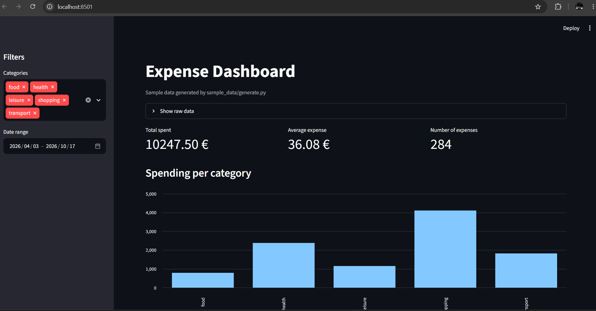
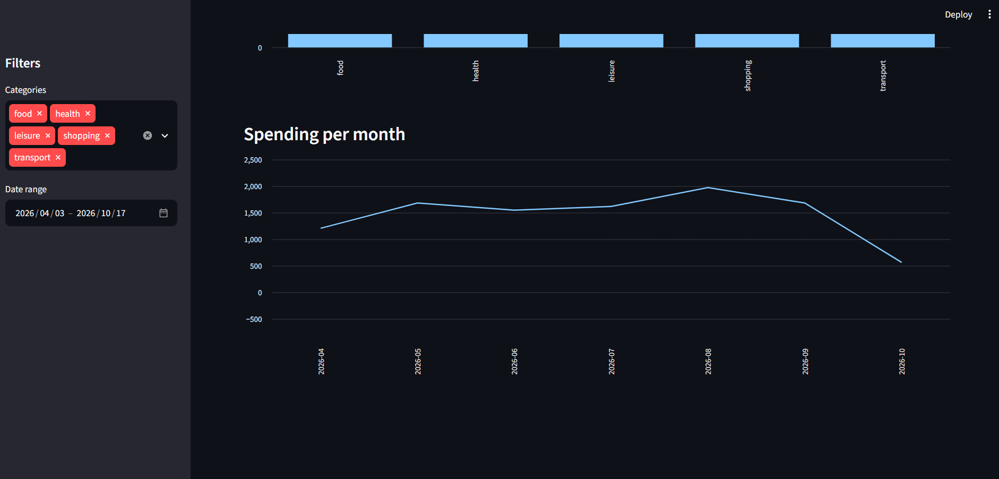

# Expense Tracker
   

A command-line tool to record, summarize and export personal expenses. Data is stored locally in SQLite.

## Features

- `add`, `list`, `summary` and `export` commands
- Data stored in SQLite
- Input validation with clear error messages
- Automated tests with pytest

## Requirements

- Python 3.10 or newer
- Git

## Installation

### On Windows (PowerShell)

```
git clone https://github.com/GuyKtn/expense-tracker.git
cd expense-tracker
python -m venv .venv
.venv\Scripts\Activate.ps1
pip install -r requirements.txt
```

### Other systems

- Git Bash: `source .venv/Scripts/activate`
- Linux or macOS: `source .venv/bin/activate`

## Usage

```
python tracker_cli.py add 12.5 --category food --note lunch
python tracker_cli.py list
python tracker_cli.py summary
python tracker_cli.py export --output my_expenses.csv
```

- `add`: saves an expense. `--day YYYY-MM-DD` is optional (default: today).
- `list`: shows all expenses and their total.
- `summary`: shows totals per category, highest first.
- `export`: writes all expenses to a CSV file (default: `expenses.csv`).

## Running the tests

```
python -m pytest
```

## Project structure

## Project structure

```
expense-tracker/
├── .github/
│   └── workflows/
│       └── test.yml           # GitHub Actions: runs the tests on every push
├── analysis/
│   └── explore.py             # pandas exploration of the expense data
├── dashboard/
│   └── app.py                 # Streamlit dashboard with filters and charts
├── sample_data/
│   ├── generate.py            # generates a reproducible sample dataset
│   └── expenses_sample.csv    # sample data used by the analysis and dashboard
├── tests/
│   ├── test_models.py         # tests for the validation rules
│   └── test_database.py       # tests for the database (in-memory SQLite)
├── tracker/
│   ├── __init__.py            # marks the folder as a Python package
│   ├── models.py              # Expense dataclass and input validation
│   └── database.py            # SQLite storage: add, list and summarize expenses
├── tracker_cli.py             # command-line interface (argparse)
├── requirements.txt           # project dependencies
├── docs/
│   └── dashboard1.png          # dashboard screenshot used in this README
└── README.md        
```

- `models.py` defines the `Expense` dataclass and raises a `ValidationError` for invalid data (non-positive amount, empty category).
- `database.py` wraps SQLite in a `Database` class that stores expenses and returns them as `Expense` objects, with a per-category summary.
- `tracker_cli.py` is the entry point: it parses commands with `argparse` and connects user input to the database.
- `tests/` contains the automated `pytest` tests. The database tests use in-memory SQLite, so they never touch real data.
- `analysis/` and `dashboard/` hold the pandas exploration and the Streamlit dashboard, which read the sample CSV from `sample_data/`.
- `.github/workflows/` runs the `pytest` tests automatically on every push and pull request.

## What I learned

- **Python:** dataclasses, custom exceptions, file handling, and the `argparse` and `csv` modules.
- **Databases:** SQLite with parameterized queries and `GROUP BY` aggregation.
- **Testing:** `pytest` with fixtures and an in-memory database, so tests never touch real data.
- **Git and GitHub:** feature branches, pull requests and a clean commit history.

## Dashboard

A Streamlit dashboard explores the expense data (sample dataset included).

```
streamlit run dashboard/app.py
```

Features: filters by category and date range, key metrics, spending per category and per month.




